# 📅 AI Agent 工程师：每日学习计划与实战打卡路线表

> **适用对象**：前端 / 全栈开发者（具备 JS/TS、React/Vue 基础，零深度学习/算法背景）  
> **核心原则**：剥离晦涩数学推导，以 **Python现代化工程、底层原生 ReAct 循环、LangGraph 状态流转、MCP 协议、Generative UI 全栈交付** 为主线。

---

## 🗺️ 课程总览图与进度映射（基于你的大纲优化升级版）

```mermaid
flowchart TD
    D1["DAY 1-3: Python现代工程与类型校验 (Pydantic/FastAPI)"] --> D7["DAY 7: Prompt工程与强制结构化输出 (Structured Outputs)"]
    D7 --> D9["DAY 9-11: 生产级 RAG 检索体系与引用溯源 (Chroma/Hybrid)"]
    D9 --> D13["DAY 13-18: 纯手写原生 ReAct 智能体 (Tool Calling 底层闭环)"]
    D13 --> D19["DAY 19-23: LangGraph 状态机与工作流编排 (StateGraph)"]
    D19 --> D24["DAY 24-29: 人机协同打断与会话恢复 (Human-in-the-loop)"]
    D24 --> D30["DAY 30-34: 工业级单 Agent 架构 (容错/重试/结构化状态)"]
    D30 --> D35["DAY 35-39: 多 Agent 协作与任务分发 (Supervisor 模式)"]
    D35 --> D40["DAY 40-42: MCP 协议开发与生态集成 (Model Context Protocol)"]
    D40 --> D43["DAY 43-46: 全链路可观测性与评估 (Langfuse Trace/Evals)"]
    D43 --> D47["DAY 47-60: 全栈流式交互 (FastAPI SSE + 前端 Generative UI)"]
    D47 --> Backend["DAY 50-53: 异步、FastAPI、日志和测试"]
    Backend --> Delivery["企业交付实战: 售后工单项目七课"]
    Delivery --> D90["DAY 61-90: 商业级端到端 Agent 综合毕业实战"]

    style D1 fill:#e0f2fe,stroke:#0284c7,stroke-width:2px
    style D7 fill:#e0f2fe,stroke:#0284c7,stroke-width:2px
    style D9 fill:#dcfce7,stroke:#16a34a,stroke-width:2px
    style D13 fill:#fef3c7,stroke:#d97706,stroke-width:2px
    style D19 fill:#fef3c7,stroke:#d97706,stroke-width:2px
    style D24 fill:#f3e8ff,stroke:#9333ea,stroke-width:2px
    style D30 fill:#f3e8ff,stroke:#9333ea,stroke-width:2px
    style D35 fill:#fce7f3,stroke:#db2777,stroke-width:2px
    style D40 fill:#fce7f3,stroke:#db2777,stroke-width:2px
    style D43 fill:#ede9fe,stroke:#7c3aed,stroke-width:2px
    style D47 fill:#ffe4e6,stroke:#e11d48,stroke-width:2px
    style D90 fill:#ffedd5,stroke:#ea580c,stroke-width:2px
```



---

## 📋 每日学习与实战代码索引表

### 🔰 阶段零：前端零基础 Python 7 步通关（先修课）
> **导读手册**：👉 [PYTHON_00_前端零基础转Python精讲手册.md](./daily_lessons/PYTHON_00_前端零基础转Python精讲手册.md)

| 课时 | 核心攻克主题 | 前端概念镜像对照 | 对应实战代码工程 | 完成打卡 |
| :---: | :--- | :--- | :--- | :---: |
| **P-01** | **变量与数据类型** | `let/const` vs 动态绑定、`null/undefined` vs `None`、模板字符串 vs `f-string` | [`phase00/lesson01_variables_and_types.py`](./phase00-python-zero-basis/lesson01_variables_and_types.py) | [ ] |
| **P-02** | **列表与字典核心方法** | `Array` (push/pop/slice) vs `List`、`Object/Map` (keys/values/entries) vs `Dict` | [`phase00/lesson02_list_dict_methods.py`](./phase00-python-zero-basis/lesson02_list_dict_methods.py) | [ ] |
| **P-03** | **控制流与推导式** | `if/else`、4 空格缩进、`enumerate()`、推导式全面替代 `filter()` + `map()` | [`phase00/lesson03_control_flow_and_comprehension.py`](./phase00-python-zero-basis/lesson03_control_flow_and_comprehension.py) | [ ] |
| **P-04** | **函数与动态传参** | 关键字传参、`*args` vs `...rest` 数组、`**kwargs` vs `{ ...options }` 对象解构 | [`phase00/lesson04_functions_args_kwargs.py`](./phase00-python-zero-basis/lesson04_functions_args_kwargs.py) | [ ] |
| **P-05** | **面向对象 Class 与 self** | `class/constructor` vs `__init__`、`this` vs `self`、`__call__` 对象转函数 | [`phase00/lesson05_oop_classes_and_self.py`](./phase00-python-zero-basis/lesson05_oop_classes_and_self.py) | [ ] |
| **P-06** | **异常处理与文件读写** | `try...catch` vs `try...except...else...finally`、`with open(...)` 自动释放句柄 | [`phase00/lesson06_exceptions_and_file_io.py`](./phase00-python-zero-basis/lesson06_exceptions_and_file_io.py) | [ ] |
| **P-07** | **模块机制与环境配置** | `import` 对照、终极揭秘 `if __name__ == '__main__'`、`venv` 隔离环境 | [`phase00/lesson07_modules_and_environment.py`](./phase00-python-zero-basis/lesson07_modules_and_environment.py) | [ ] |

---

### 🚀 阶段一至阶段六：AI Agent 工业级实战进阶

| 学习阶段 / 日期 | 每日核心主题 | 关键知识点（结合前端思维映射） | 对应讲义文档 | 对应实战代码工程 | 打卡状态 |
| :--- | :--- | :--- | :--- | :--- | :---: |
| **DAY 1** | **Python 现代工程起步** | Python 3.11+ 核心语法、`asyncio` 异步模型 vs JS Event Loop、包管理工具 | [DAY_01 讲义](./daily_lessons/DAY_01_Python核心与前端对照.md) | [`phase02/day01_python_basics.py`](./phase02-python-fastapi/day01_python_basics.py) | [ ] |
| **DAY 2** | **Pydantic v2 强类型** | Python 版的 Zod：字段校验、默认值、自动生成 JSON Schema 用于工具描述 | [DAY_01 讲义](./daily_lessons/DAY_01_Python核心与前端对照.md) | [`phase02/day02_pydantic_validation.py`](./phase02-python-fastapi/day02_pydantic_validation.py) | [ ] |
| **DAY 3** | **FastAPI 异步微服务** | 对标 Express/Koa：异步路由、依赖注入、跨域配置、长任务并发支持 | [DAY_01 讲义](./daily_lessons/DAY_01_Python核心与前端对照.md) | [`phase02/day03_fastapi_server.py`](./phase02-python-fastapi/day03_fastapi_server.py) | [ ] |
| **DAY 5** | **大模型机理与流式交互** | Token 计费、Context Window、Temperature 温度、SSE 打字机通信 | [阶段一概览](./01-阶段一：LLM核心概念与Prompt工程.md) | [`phase01-basics/02-streaming.ts`](./phase01-basics/02-streaming.ts) | [ ] |
| **DAY 7** | **Prompt 进阶与结构化输出** | Few-Shot 样本、CoT 链式思考、`Structured Outputs` 强制 100% 格式约束 | [DAY_07 讲义](./daily_lessons/DAY_07_Prompt进阶与结构化输出.md) | [`phase03/day07_structured_output.py`](./phase03-native-agent/day07_structured_output.py) | [ ] |
| **DAY 9** | **RAG 向量检索体系** | 文档智能分块（Chunking）、Embedding 向量化、Chroma 本地向量数据库 | [DAY_09 讲义](./daily_lessons/DAY_09_RAG知识库与向量检索.md) | [`phase04/day09_vector_rag.py`](./phase04-rag-system/day09_vector_rag.py) | [ ] |
| **DAY 11** | **RAG 效果优化与溯源** | 来源引用标注（Source Citations）、Top-K 调优、防幻觉系统约束 | [DAY_09 讲义](./daily_lessons/DAY_09_RAG知识库与向量检索.md) | [`phase04/day11_advanced_rag_rerank.py`](./phase04-rag-system/day11_advanced_rag_rerank.py) | [ ] |
| **DAY 13** | **手写原生 ReAct 智能体** | **核心基石**：脱离框架手写 Thought -> Action -> Observation 的 `while` 闭环 | [DAY_13 讲义](./daily_lessons/DAY_13_原生ReAct智能体手写实战.md) | [`phase03/day13_native_react_agent.py`](./phase03-native-agent/day13_native_react_agent.py) | [ ] |
| **DAY 19** | **LangGraph 状态图与流** | State 接口（类似 Redux Store）、Node 节点、Edge 边、条件分支路由 | [DAY_19 讲义](./daily_lessons/DAY_19_LangGraph状态图与工作流.md) | [`phase05/day19_langgraph_basics.py`](./phase05-langgraph-mcp/day19_langgraph_basics.py) | [ ] |
| **DAY 24** | **人机协同与状态恢复** | `interrupt_before` 状态挂起、MemorySaver 检查点快照、人工审批后恢复流转 | [DAY_24 讲义](./daily_lessons/DAY_24_人机协同与状态恢复.md) | [`phase05/day24_human_in_the_loop.py`](./phase05-langgraph-mcp/day24_human_in_the_loop.py) | [ ] |
| **DAY 35** | **多 Agent 协作系统** | Supervisor 主管调度模式：任务动态拆解、研究员 Agent 与审核员 Agent 分工 | [DAY_19 讲义](./daily_lessons/DAY_19_LangGraph状态图与工作流.md) | [`phase05/day35_multi_agent_supervisor.py`](./phase05-langgraph-mcp/day35_multi_agent_supervisor.py) | [ ] |
| **DAY 40** | **MCP 协议标准化工具开发** | Anthropic 官方 Model Context Protocol 规范：开发标准 MCP 工具服务 | [DAY_40 讲义](./daily_lessons/DAY_40_MCP协议与工具扩展.md) | [`phase05/day40_mcp_server.py`](./phase05-langgraph-mcp/day40_mcp_server.py) | [ ] |
| **DAY 43** | **链路追踪与可观测性** | Langfuse 生产监控接入：时延分析、Token 成本计算、调用链瀑布图追踪 | [DAY_40 讲义](./daily_lessons/DAY_40_MCP协议与工具扩展.md) | [`phase05/day43_langfuse_observability.py`](./phase05-langgraph-mcp/day43_langfuse_observability.py) | [ ] |
| **DAY 47** | **全栈流式与 Generative UI** | FastAPI 结构化 SSE 服务 + 前端 React 动态交互卡片（Generative UI） | [DAY_47 讲义](./daily_lessons/DAY_47_全栈流式Agent与GenerativeUI.md) | [`phase06/day47_backend_sse_stream.py`](./phase06-fullstack-agent/day47_backend_sse_stream.py)<br>[`phase06/day47_frontend_generative_ui.tsx`](./phase06-fullstack-agent/day47_frontend_generative_ui.tsx) | [ ] |
| **DAY 60-90** | **企业级商业项目实战** | 端到端智能体项目综合落地、SaaS 化多租户权限设计与求职简历包装 | [阶段六概览](./06-阶段六：企业级毕业项目与简历包装指南.md) | 毕业项目专属架构方案 | [ ] |

---

## 后端工程基础

| 课时 | 讲义 | 配套代码 | 完成打卡 |
| --- | --- | --- | --- |
| DAY 50 | [Python 异步编程详解](./daily_lessons/DAY_50_Python异步编程详解.md) | [异步示例](./phase07-backend-engineering/day50_async_python.py) | [ ] |
| DAY 51 | [FastAPI 工程化与方法全解](./daily_lessons/DAY_51_FastAPI工程化与方法全解.md) | [FastAPI 示例](./phase07-backend-engineering/day51_fastapi_engineering.py) | [ ] |
| DAY 52 | [配置管理与链路追踪日志](./daily_lessons/DAY_52_配置管理与链路追踪日志.md) | [配置与日志示例](./phase07-backend-engineering/day52_settings_and_logging.py) | [ ] |
| DAY 53 | [单元测试与大模型 Mock](./daily_lessons/DAY_53_单元测试与大模型Mock.md) | [pytest 和 Mock 示例](./phase07-backend-engineering/day53_pytest_mock_llm.py) | [ ] |

## 企业交付实战

以下七课共用 [售后工单项目](./phase08-enterprise-agent/README.md)。项目说明包含 PowerShell 启动、端到端验收和部署步骤。

| 课时 | 讲义 | 配套代码 | 完成打卡 |
| --- | --- | --- | --- |
| 第 1 课 | [需求拆解与工单状态机](./daily_lessons/企业实战_01_需求拆解与工单状态机.md) | [状态与表结构](./phase08-enterprise-agent/support_agent/models.py)、[输入输出契约](./phase08-enterprise-agent/support_agent/schemas.py) | [ ] |
| 第 2 课 | [SQLAlchemy 事务与 Alembic 迁移](./daily_lessons/企业实战_02_SQLAlchemy事务与Alembic迁移.md) | [数据库入口](./phase08-enterprise-agent/support_agent/db.py)、[初始迁移](./phase08-enterprise-agent/migrations/versions/0001_initial.py) | [ ] |
| 第 3 课 | [状态恢复、幂等与并发](./daily_lessons/企业实战_03_状态恢复幂等与并发.md) | [创建与审批](./phase08-enterprise-agent/support_agent/workflow.py) | [ ] |
| 第 4 课 | [鉴权、数据隔离与审计](./daily_lessons/企业实战_04_鉴权数据隔离与审计.md) | [身份依赖](./phase08-enterprise-agent/support_agent/security.py)、[API](./phase08-enterprise-agent/support_agent/main.py) | [ ] |
| 第 5 课 | [知识库导入、更新与检索](./daily_lessons/企业实战_05_知识库导入更新与检索.md) | [检索与文档管理](./phase08-enterprise-agent/support_agent/knowledge.py) | [ ] |
| 第 6 课 | [自动化测试与 Agent 评测](./daily_lessons/企业实战_06_自动化测试与Agent评测.md) | [集成测试](./phase08-enterprise-agent/tests/test_delivery.py)、[评测运行器](./phase08-enterprise-agent/evals/run.py) | [ ] |
| 第 7 课 | [Docker 部署、CI 与线上排障](./daily_lessons/企业实战_07_Docker部署CI与线上排障.md) | [Compose](./phase08-enterprise-agent/compose.yaml)、[CI](./.github/workflows/enterprise-agent.yml) | [ ] |

## 🏃 快速启动指引

1. **安装 Python 依赖库**：
   ```bash
   pip install openai pydantic fastapi uvicorn sse-starlette chromadb langgraph langchain-core mcp langfuse
   ```
2. **配置环境变量**：
   在项目根目录创建 `.env` 文件并填入 API Key：
   ```env
   OPENAI_API_KEY=your_api_key_here
   OPENAI_BASE_URL=https://api.openai.com/v1 # 或者代理商/兼容端点地址
   ```
3. **每日学习顺序**：
   先读对应天数的讲义文档 → 阅读实战代码中的详细中文注释 → 运行并调试代码 → 完成打卡！
