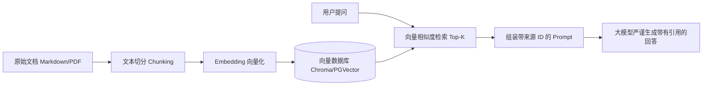

# DAY 09 ~ DAY 11：RAG 生产级知识检索闭环与防幻觉控制

> **目标**：理解 RAG（检索增强生成）解决的核心痛点（私有数据盲区、时效性差、幻觉），掌握向量化检索与防幻觉引用标注。

---

## 1. 为什么有大模型还要 RAG？

| 对比维度 | 纯微调 (Fine-tuning) | 检索增强生成 (RAG) |
| :--- | :--- | :--- |
| **知识更新** | 必须重新训练/微调权重，极慢且昂贵 | 直接向数据库写入新切片，秒级生效 |
| **准确度与幻觉** | 依然可能凭空捏造事实 | 基于真实文档片段作答，可附带文档 ID |
| **数据权限控制** | 模型权重中所有数据混在一起，无法权限隔离 | 可以在检索阶段按用户角色进行元数据过滤 |
| **成本与算力** | 需要专业 GPU 算力集群与算法人员 | 普通应用开发即可基于向量库快速搭建 |

---

## 2. 生产级 RAG 的五步流水线

1. **分块（Chunking）**：按语义、段落或标题层级切分成 300~800 字符的片段。
2. **向量化（Embedding）**：通过嵌入模型将文本映射为高维浮点数向量（如 1536 维）。语义越接近，向量的夹角余弦值越小。
3. **入库与索引**：写入支持向量索引（如 HNSW、IVF）的数据库。
4. **混合召回（Hybrid Retrieval）**：结合向量余弦相似度 + 关键词全文检索。
5. **重排序（Rerank）与来源标注**：取最相关的 3~5 篇，强制大模型按文档 ID 标注引用。

---

## 🛠️ 今日对应实战源码
- 基础切片与向量库检索：[`phase04-rag-system/day09_vector_rag.py`](../phase04-rag-system/day09_vector_rag.py)
- 生产级来源引用与防幻觉：[`phase04-rag-system/day11_advanced_rag_rerank.py`](../phase04-rag-system/day11_advanced_rag_rerank.py)
