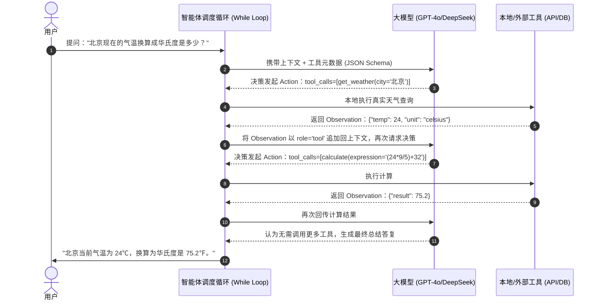

# DAY 13：核心基石 —— 纯手写原生 ReAct 智能体循环

> **目标**：脱离一切上层框架（LangChain 等），用最底层的 API 调用手写一个工业级 ReAct 循环。搞懂了这个，所有 Agent 框架在你眼前都不再是黑盒。

---

## 1. 什么是 ReAct 范式？

ReAct 是 **Reasoning（思考/推理） + Acting（行动/工具调用）** 的合成词。
在没有工具调用能力之前，大模型只能“纸上谈兵”。ReAct 赋予了模型与外部真实世界互动的能力：

---

## 2. 调度循环的三大防线

纯手写 ReAct 必须注意三点工业级安全考量：
1. **最大步数限制（Max Turns）**：必须设置比如 `max_turns = 6`。如果大模型陷入“调用工具失败 -> 重试 -> 再失败”的死循环，步数达到上限强制熔断退出，防止烧穿 API Token 预算。
2. **工具异常隔离**：调用本地工具时必须加上 `try...except`，把错误信息作为 Observation 返回给模型，让模型自主根据报错调整传参。
3. **上下文不可变与状态追加**：严格保证每一步的消息格式规范（`assistant.tool_calls` 与 `tool.tool_call_id` 必须严格一对一匹配）。

---

## 🛠️ 今日对应实战源码
请务必一行行细读并亲自在终端跑通本实战代码：
- 原生 ReAct 引擎源码：[`phase03-native-agent/day13_native_react_agent.py`](../phase03-native-agent/day13_native_react_agent.py)
