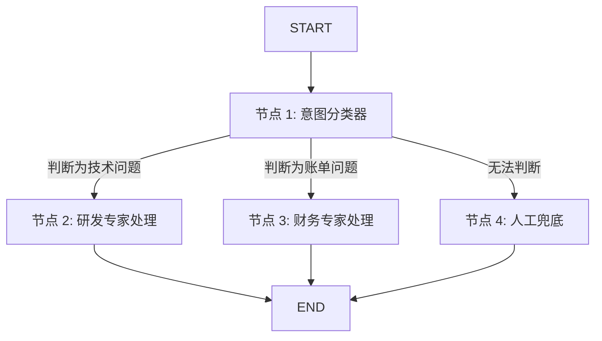

# DAY 14：LangGraph 状态图与现代工作流编排

> **目标**：理解为什么线性 Prompt 和简单的 While 循环在复杂企业业务中会失效，学习用“状态图（Graph）”和“不可变状态流（StateFlow）”重构复杂 Agent 系统。

---

## 1. 为什么是 LangGraph？（前端视角的降维理解）

在传统 LangChain 中，调用链是线性的（DAG / Chain），不能循环，不能分支，不能跳步。
现实中的业务需求往往是：
- “先分类，分类失败重试；分类成功后，A 分支走财务，B 分支走客服；如果金额大于 1 万，暂停等待主管审批，审批通过再继续。”

这在前端眼里是什么？**这不就是一个典型的有限状态机（Finite State Machine / XState）或者 Redux 数据流吗！**
LangGraph 的核心思想：
- **State（状态容器）**：整个图流转共享的数据模型。
- **Nodes（节点）**：接收 state，执行动作，返回更新后的字段。
- **Edges（边）**：决定下一个执行哪个节点。包含条件边（Conditional Edge）。

---

## 2. 状态图的核心架构要素

---

## 🛠️ 今日对应实战源码
- LangGraph 状态图基础与分支路由：[`phase05-langgraph-mcp/day19_langgraph_basics.py`](../phase05-langgraph-mcp/day19_langgraph_basics.py)
- Supervisor 多 Agent 主管派单模式：[`phase05-langgraph-mcp/day35_multi_agent_supervisor.py`](../phase05-langgraph-mcp/day35_multi_agent_supervisor.py)
