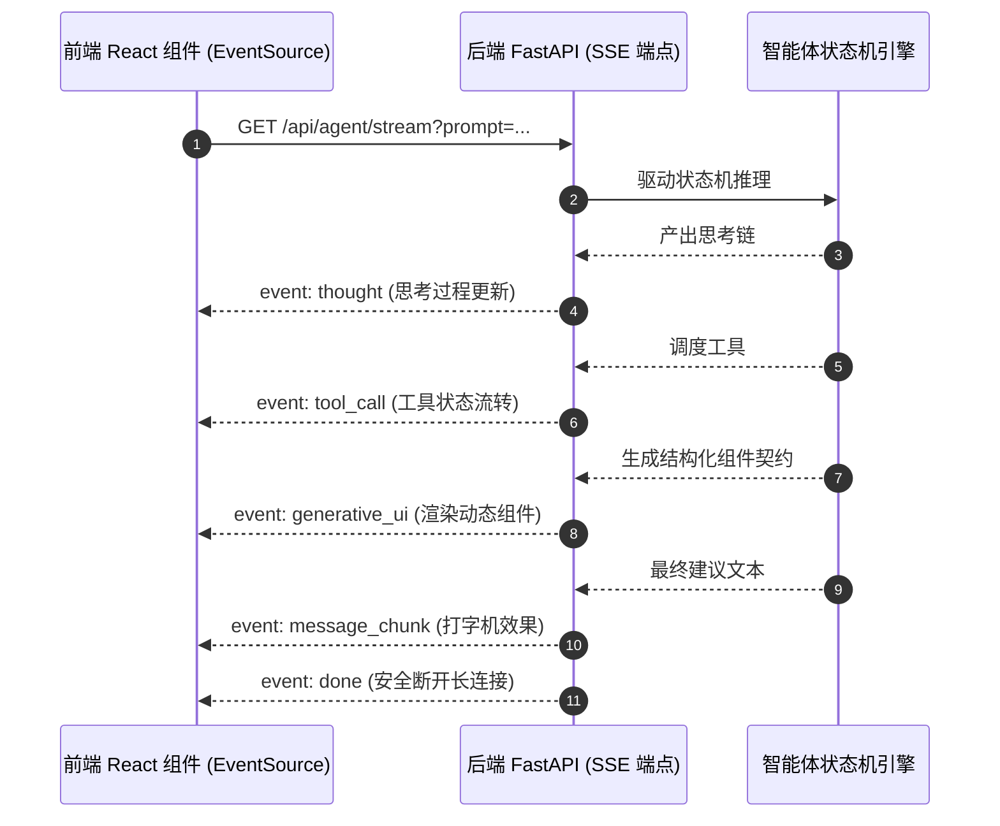

# DAY 19：全栈流式交互与 Generative UI（前端的杀手锏）

> **目标**：彻底拉开你与普通 Python 开发者的差距！普通后端只能吐黑白字符终端，而你可以交付带有**思考链折叠、工具执行动效、结构化卡片（Generative UI）交互**的商业级 Web 应用。

---

## 1. 什么是 Generative UI（生成式 UI）？

传统的 AI 对话：
- 用户：“帮我查一下苹果公司的股票和财务数据。”
- AI 吐出一长串晦涩难懂的纯 Markdown 表格或文字。

**Generative UI 的做法：**
- AI 在后台分析数据后，不是吐文字，而是下发一个特定事件：
  ```json
  {
    "event": "generative_ui",
    "data": {
      "component_type": "StockCardWidget",
      "props": { "symbol": "AAPL", "price": 224.2, "trend": "up" }
    }
  }
  ```
- 前端 React/Vue 动态挂载 `<StockCardWidget />` 组件，带有涨跌红绿高亮、走势微图、以及交互按钮（如【一键加入自选】）。
- **用户体验从“看 AI 聊天”升维为“与 AI 驱动的软件交互”！**

---

## 2. 前后端数据流转架构



---

## 🛠️ 今日对应实战源码
- FastAPI 结构化 SSE 服务端：[`phase06-fullstack-agent/day47_backend_sse_stream.py`](../phase06-fullstack-agent/day47_backend_sse_stream.py)
- React + TypeScript 流式交互客户端：[`phase06-fullstack-agent/day47_frontend_generative_ui.tsx`](../phase06-fullstack-agent/day47_frontend_generative_ui.tsx)
