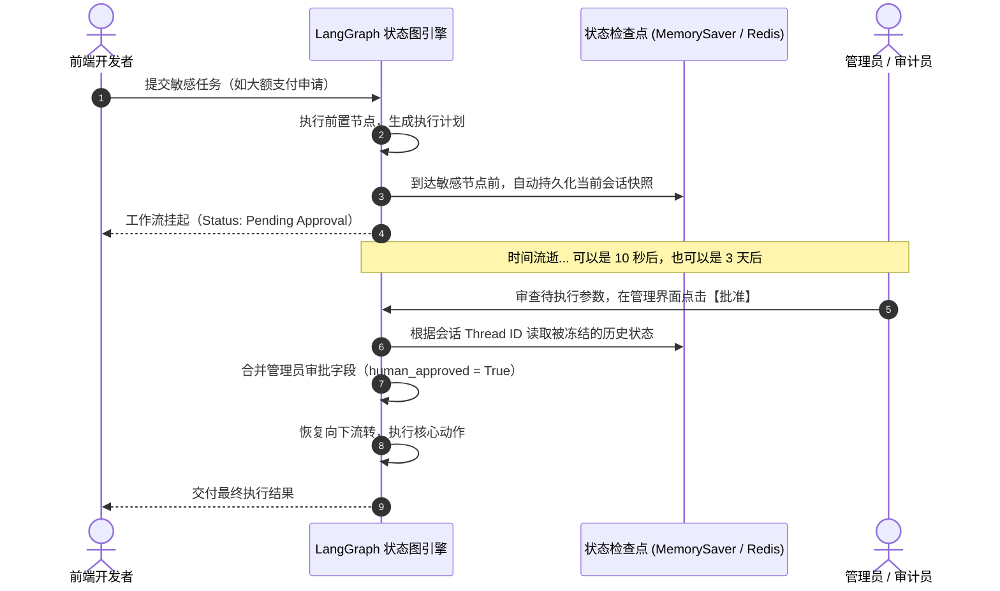

# DAY 24 ~ DAY 29：人机协同（Human-in-the-loop）与状态持久化

> **目标**：掌握在复杂 Agent 中实现“执行挂起、保存会话快照、等待人工审核、外部唤醒恢复”的生产级机制。

---

## 1. 为什么“人在回路”是 Agent 商业化落地的必须项？

很多初学者误以为 Agent 必须是 100% 全自动的。但现实世界中：
- 自动给全体客户发公关邮件？**风险极高，必须人工 Review 文案！**
- 自动给用户退款 100 万元？**违规高危，必须主管批准！**
- 自动执行数据库 DROP TABLE 指令？**致命灾难！**

因此，**“人机协同（Human-in-the-loop）”是企业敢把 Agent 接入生产核心系统的唯一前提**。

---

## 2. 状态挂起与恢复的运行机制

---

## 🛠️ 今日对应实战源码
- 人机协同打断与检查点恢复实战：[`phase05-langgraph-mcp/day24_human_in_the_loop.py`](../phase05-langgraph-mcp/day24_human_in_the_loop.py)
