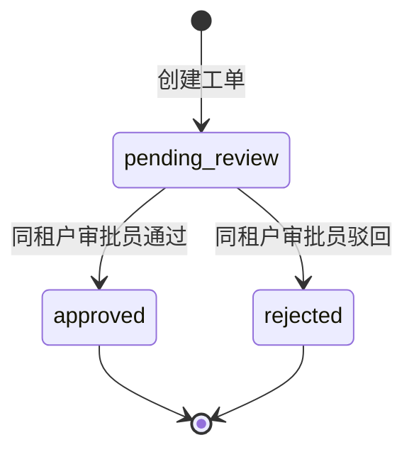

# 企业实战第 1 课  需求拆解、接口契约与工单状态机

配套代码 [状态和数据模型](../phase08-enterprise-agent/support_agent/models.py) · [API 入参和响应](../phase08-enterprise-agent/support_agent/schemas.py) · [启动与实操](../phase08-enterprise-agent/README.md)

## 1. 把“做一个售后 Agent”改写成能验收的需求

客服团队需要快速回答常见售后问题。用户提交问题后，系统检索该用户有权阅读的资料。命中时展示原文和出处，找不到唯一适用来源时给出转人工选项。用户选择转人工后创建工单，审批员处理，用户查询结果。

| 角色 | 操作 | 验收样例 |
| --- | --- | --- |
| 用户 | 提问、建单、查看自己的工单 | 退货问题返回政策和来源。安装问题走转人工。 |
| 审批员 | 查看同租户工单、审批、查审计、管理知识文档 | 审批后用户能读到结果，每个成功操作产生一条对应的工单事件。 |
| 服务维护者 | 部署、观测、故障恢复 | 进程重启后还能审批原工单，根据响应头里的请求 ID 能找到日志。 |

接口设计上，把查询知识库与创建工单拆成两个操作。前者可以反复提问，后者需要用户确认及幂等键。课程版的审批动作只修改工单状态，接入退款系统时需要额外的外部执行记录与对账。

## 2. 定义可达状态和允许的迁移

相同审批员重试同一个决定会收到已有状态。这次请求没有发生新的迁移。终态后改为另一种决定时返回 409。将来如果业务允许撤回，可以新增明确的撤回操作和审计事件，并写出对应的权限与并发规则。

## 3. 给前后端一份接口契约

| 请求 | 输入 | 成功行为 |
| --- | --- | --- |
| `POST /agent/answer` | `question` | 200，`route` 为 `answer` 或 `transfer`。有答案时附 `citation`。 |
| `POST /tickets` | `question` 和请求头 `Idempotency-Key` | 首次 201。相同请求重放 200，返回当前工单快照。 |
| `GET /tickets/{ticket_id}` | 路径中的工单 ID | 200，返回当前状态。 |
| `POST /tickets/{ticket_id}/review` | `decision` 为 `approved` 或 `rejected` | 200，返回处理后的工单。 |
| `GET /tickets/{ticket_id}/events` | 工单 ID，审批员身份 | 200，按顺序返回审计记录。 |

HTTP 错误在前端有具体含义。401 走重新登录，403 提示角色不允许，404 显示工单不可用，409 刷新工单或修正重复请求，422 显示输入校验问题。

## 4. 代码里的方法与类型

| 写法 | 作用及输入输出 | 类似写法和使用场景 |
| --- | --- | --- |
| `class Status(StrEnum)` | 定义有限的工单状态。用 `Status("approved")` 得到枚举成员，用 `.value` 得到存储值。 | `Literal` 适合限定单个函数或字段的取值。普通 `Enum` 适合成员值类型不全是字符串的情况。 |
| `Annotated[str, StringConstraints(...)]` | 约束传入字符串。这里先裁剪两端空白，再校验长度，并将规则反映到 API Schema。 | `Field(min_length=...)` 可直接约束模型字段。多字段依赖可用 `model_validator`。 |
| `ConfigDict(extra="forbid")` | 明确拒绝请求体中的未声明字段，例如客户端提交的 `tenant_id`。 | `extra="ignore"` 适合兼容调用者带来的附加字段。`extra="allow"` 适合确实需要保存扩展字段的对象。 |
| `TicketView.model_validate(ticket)` | 从 ORM 对象提取响应模型声明的属性，返回 Pydantic 实例。这里要求 `from_attributes=True`。 | `model_validate_json(raw)` 接收 JSON 字符串或字节。`model_dump()` 将已校验实例转成字典。 |

## 5. 动手验收

先写出“同一请求发两次”和“两位审批员几乎同时操作”两个验收场景，再读 [并发用例](../phase08-enterprise-agent/tests/test_delivery.py)。尝试补一个“审批请求超时，但数据库已经提交”的场景，写清前端要重试哪一个请求，以及它应该收到什么状态。
